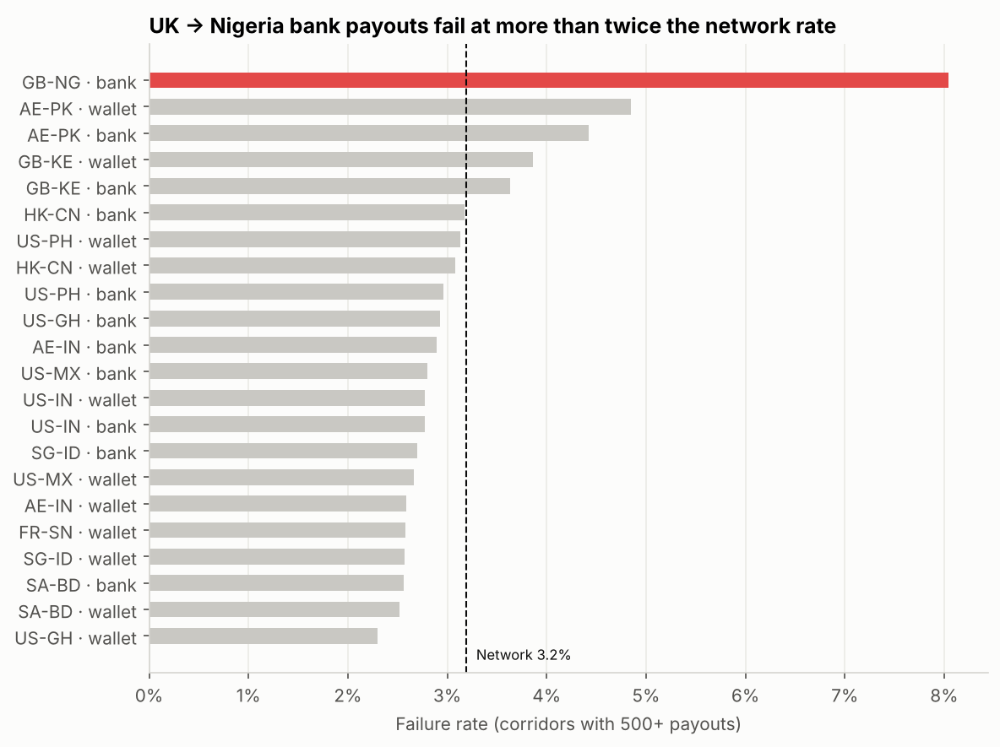
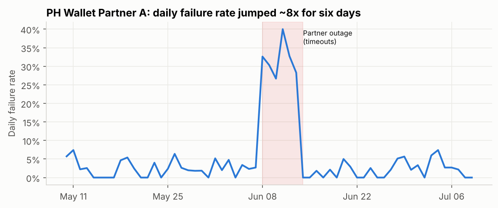
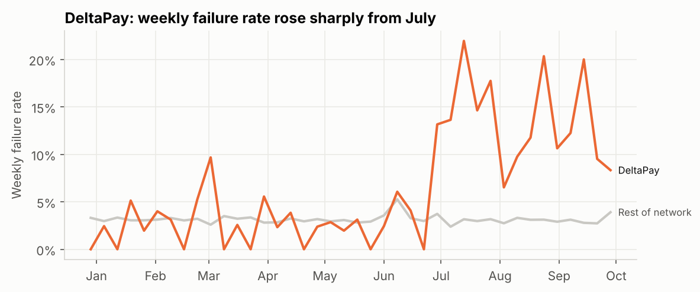
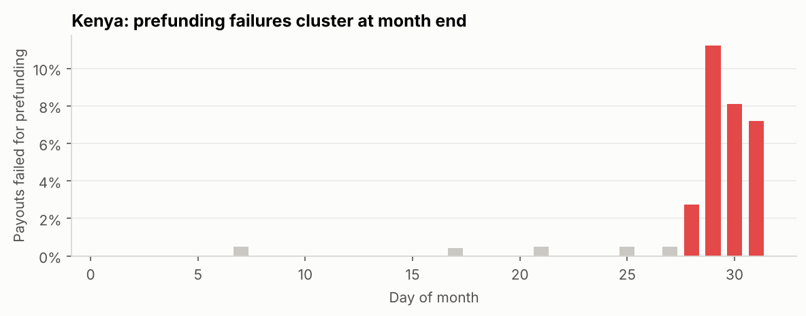

# Cross-Border Payments Analytics

**Where is a real-time payout network losing reliability, speed and revenue, and what should each team do about it?**

An end-to-end BI project on ~120,000 cross-border payouts (Jan to Sep 2026) sent by 40 member businesses (gig platforms, remittance companies, fintechs, PSPs and banks) across 12 corridors to mobile wallets and bank accounts.

**Tools:** SQL (DuckDB: CTEs, window functions) · Python (pandas, matplotlib) · Tableau · Jupyter

> **About the data:** the dataset is synthetic, generated by [`src/generate_data.py`](src/generate_data.py) to mirror how a real-time payments network works (corridors, payout partners, FX, fees, failure reasons, batch bank rails). All company and partner names are fictional. It includes realistic business problems and data quality issues for the analysis to uncover.

---

## Key findings

| # | Finding | Why it matters |
|---|---|---|
| 1 | **UK → Nigeria bank payouts fail 8.0% of the time, 2.5x the 3.2% network rate.** 76% of those failures are invalid account details. | The problem is bad recipient data at the sender, so a pre-validation check would prevent most of it. |
| 2 | **A 6-day outage at one Philippine wallet partner (June 8–13)** pushed its daily failure rate from ~3% to as high as 40%. An automated SQL check flags it on day one. | A daily alert plus automatic rerouting to the second PH wallet partner would have prevented most of these failures. |
| 3 | **One fintech member's failure rate jumped from 2.7% to 14.3%** from July, driven by name mismatches and invalid account details. | The cause sits in the member's own recipient-capture flow. Account management can catch this early with a member health check. |
| 4 | **Kenya prefunding failures cluster in the last 3 days of the month** (8.3% of payouts vs under 0.1% the rest of the month). | Treasury can top up the Kenya balance before month end. |
| 5 | **Weekend bank payouts to India, Pakistan and Bangladesh take a median 6–7 hours** vs 1.5 minutes on weekdays (India, Pakistan). | Members need honest weekend ETAs, or a nudge toward wallet payouts. |
| 6 | **Invalid account details and name mismatches cause ~49% of revenue lost to failures.** Failed payouts total ~$1.0M in value. | One fix, recipient pre-validation, addresses half the problem. |

Business context: daily payouts grew **41%** from January to September, revenue was **$365K** at a **123 bps** take rate, and the top 3 members drive 27% of revenue.

<p align="center">
  
  
</p>
<p align="center">
  
  
</p>

## Recommendations

| Owner | Action |
|---|---|
| Product | Recipient pre-validation (account format and name check) before a payout is submitted. Start with UK → Nigeria. |
| Operations | Turn the incident query (Q5) into a daily alert and auto-route traffic to the backup partner when it fires. |
| Account management | Weekly member health review: flag any member whose failure rate rises more than 3 points. |
| Treasury | Pre-fund Kenya before day 27 each month, sized on month-end volume. |
| Product + Sales | Show weekend ETAs for bank payouts to IN, PK and BD. Promote wallet payouts where available. |

---

## Project structure

```
payments-analytics/
├── data/
│   ├── raw/                 # raw extract (transactions gzipped), members, payout partners
│   └── clean/               # cleaned transactions + data quality report
├── sql/                     # 10 business queries (01_kpi_summary.sql ... 10_revenue_lost_to_failures.sql)
├── src/
│   ├── generate_data.py     # builds the synthetic raw data
│   ├── clean_data.py        # data quality checks + cleaning + Tableau extract
│   ├── run_sql.py           # runs every query with DuckDB, saves results
│   └── build_notebook.py    # builds and runs the analysis notebook
├── notebooks/payments_analysis.ipynb   # the full analysis with charts
├── outputs/sql_results/     # CSV result of every query
├── tableau/payments_tableau.csv        # one flat file for the Tableau dashboard
├── docs/
│   ├── data_dictionary.md   # every table, field and metric definition
│   └── tableau_dashboard_spec.md
└── images/                  # charts used in this README
```

## SQL queries

| Query | Business question | Techniques |
|---|---|---|
| [01](sql/01_kpi_summary.sql) | Headline KPIs: volume, success rate, revenue, take rate, speed | Aggregates, conditional sums |
| [02](sql/02_monthly_trend.sql) | Monthly growth, adjusted for days in the month | CTE, `LAG` |
| [03](sql/03_corridor_performance.sql) | Corridor scorecard: reliability, p50/p90 speed, revenue | `QUANTILE_CONT`, `RANK` |
| [04](sql/04_failure_reasons.sql) | Top failure reason per corridor | `ROW_NUMBER`, `PARTITION BY` |
| [05](sql/05_partner_incident_detection.sql) | Automatic partner incident detection vs a 28-day baseline | Rolling window frame |
| [06](sql/06_member_health.sql) | Which members' failure rates got worse? | Period comparison, self-join |
| [07](sql/07_month_end_prefunding.sql) | Do prefunding failures cluster at month end? | Date logic |
| [08](sql/08_weekend_bank_delays.sql) | How much slower are weekend bank payouts? | `FILTER` clauses, median |
| [09](sql/09_revenue_concentration.sql) | Revenue concentration (Pareto) | Running total window |
| [10](sql/10_revenue_lost_to_failures.sql) | What do failures cost by reason? | CTE join, share of total |

## Data quality

The raw extract had the problems a real export has. [`src/clean_data.py`](src/clean_data.py) handles each one and logs it to [`data/clean/data_quality_report.csv`](data/clean/data_quality_report.csv):

| Check | Rows | Action |
|---|---|---|
| Exact duplicate rows (retried export) | 478 | Dropped |
| Status labels with wrong case or spaces | 299 | Standardized |
| Zero or negative amounts (test payouts) | 45 | Dropped |
| Failure reason on a successful payout | 60 | Cleared |
| Missing fee on completed payout | 180 | Rebuilt from the segment's fee schedule |

99.6% of raw rows were kept.

## How to run

```bash
pip install -r requirements.txt
python src/generate_data.py      # raw data
python src/clean_data.py         # clean data + data quality report + Tableau file
python src/run_sql.py            # run all 10 queries
python src/build_notebook.py     # run the analysis notebook and refresh charts
```

---

**Shrujal Agarwal** · [LinkedIn](https://www.linkedin.com/in/shrujalagarwal) · [Tableau Public](https://public.tableau.com/app/profile/shrujal.agarwal)
